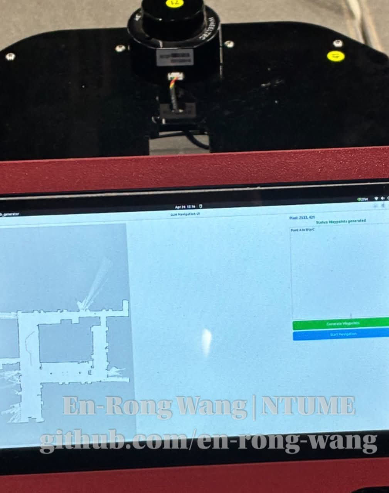

# Autonomous-Mobile-Robot
Developed a ROS 2-based autonomous mobile robot integrating LiDAR-based mapping, localization, path planning, obstacle avoidance, and real-time object tracking using YOLOv26 and an Intel RealSense depth camera on NVIDIA Jetson Nano.
## LiDAR-Based Indoor Navigation with ROS 2 Nav2

<table>
  <tr>
    <td align="center" width="50%">
      
    </td>
    <td align="center" width="50%">
      
    </td>
  </tr>
  <tr>
    <td valign="top">
      <b>2D LiDAR Mapping with GMapping SLAM</b>
        
      Mapped a basement with an N10P 2D LiDAR and GMapping SLAM, then saved the occupancy grid as a PGM image for robot localization and navigation.
    </td>
    <td valign="top">
      <b>ROS 2 Nav2 Costmap and Navigation Tuning</b>
        
      Nav2 costmap visualization showing inflated cost regions around obstacles. I used YAML configuration files to tune the costmap’s inflation radius, set velocity and acceleration limits, and adjust goal tolerances.
    </td>
  </tr>
</table>
<h3>Related Demo</h3>

The following demo shows the process of building a 2D occupancy grid map of the basement using LiDAR and GMapping SLAM.

https://github.com/user-attachments/assets/8539b31c-bf0d-4a4e-a11b-31c6925fc06b

A mobile robot navigates a LiDAR-mapped basement using ROS 2 Nav2, with A* for global route planning and DWA for local obstacle avoidance.

<table>
  <tr>
    <td width="50%" valign="top">
      <video src="https://github.com/user-attachments/assets/cadb2c05-b4f2-4bb0-a8b7-2627e3a33cd1
" controls width="100%"></video>
    </td>
    <td width="50%" valign="top">
      <video src="https://github.com/user-attachments/assets/01593e59-d68c-4175-b6b7-8cb63f1a8b80" controls width="100%"></video>
    </td>
  </tr>
</table>

## Gemini-Assisted Natural Language Navigation
Integrated the Gemini API with ROS 2 nodes to interpret natural language commands entered through a human–machine interface. Using predefined waypoint coordinates (A, B, and C) stored in a ROS 2 node, Gemini translates user intent into a sequence of navigation goals. These goals are passed to the navigation stack to plan paths on an existing occupancy grid map generated using 2D LiDAR, enabling users to specify destinations and visiting order through natural language.

<table>
  <tr>
    <td width="40%" valign="top">
      
    </td>
    <td width="60%" valign="top">
      <video src="https://github.com/user-attachments/assets/14d3a8d9-6989-425d-9656-ee056425fc7f" controls width="100%"></video>
    </td>
  </tr>
</table>

## Tennis Ball Detection and Tracking on NVIDIA Jetson Nano

Developed an onboard tennis ball tracking system for a mobile robot using an Intel RealSense depth camera and YOLOv26.

- Annotated tennis ball images in Roboflow and used the resulting dataset to obtain custom YOLOv26 model weights.
- Implemented the detection and tracking pipeline in PyTorch and deployed it on an NVIDIA Jetson Nano with CUDA-accelerated inference.
- Combined YOLO detections with RealSense depth measurements to track the ball’s position and estimate its distance from the camera. Detection confidence reached up to 97% during testing.

### Experimental Demonstration

https://github.com/user-attachments/assets/629337b3-fdf8-486e-9139-cabb3447a99d

