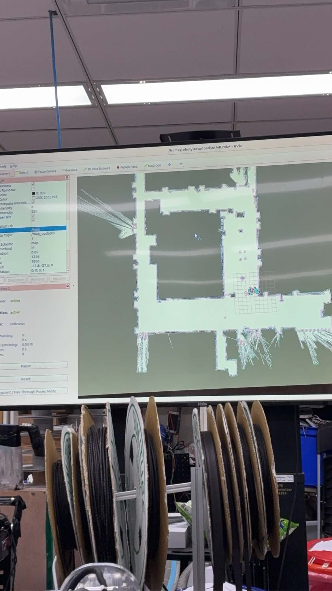
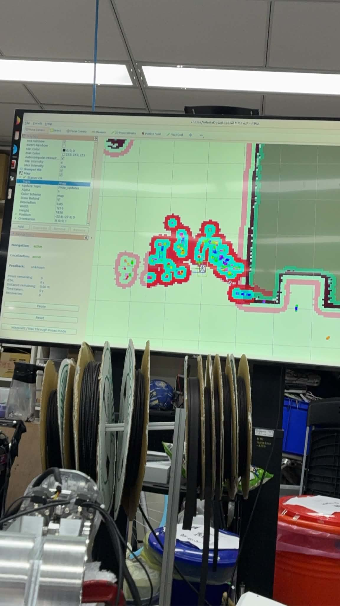

# Autonomous-Mobile-Robot
Developed a ROS 2-based autonomous mobile robot integrating LiDAR-based mapping, localization, path planning, obstacle avoidance, and real-time object tracking using YOLOv26 and an Intel RealSense depth camera on NVIDIA Jetson Nano.
## LiDAR-Based Indoor Navigation with ROS 2 Nav2

<table>
  <tr>
    <td align="center" width="50%">
      
    </td>
    <td align="center" width="50%">
      
    </td>
  </tr>
  <tr>
    <td valign="top">
      <b>2D LiDAR Mapping with GMapping SLAM</b>
        
      Mapped a basement with an N10P 2D LiDAR and GMapping SLAM, then saved the occupancy grid as a PGM image for robot localization and navigation.
    </td>
    <td valign="top">
      <b>ROS 2 Nav2 Costmap and Navigation Tuning</b>
        
      Nav2 costmap visualization showing inflated cost regions around obstacles. I used YAML configuration files to tune the costmap’s inflation radius, set velocity and acceleration limits, and adjust goal tolerances.
    </td>
  </tr>
</table>

